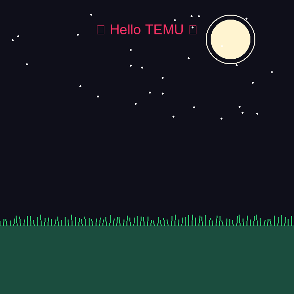

# 🌳 Hello TEMU - Animated Python Tree of Life

A creative, procedural generative art script built in Python using the **Pillow** library. It renders an animated night-sky scene featuring a glowing moon, twinkling stars, grassy terrain, progressive tree branch growth, blossoming pastel leaves, and vibrant multi-colored glowing fruits—culminating in a personalized greeting.

---

## 🎨 Preview



*(If the GIF doesn't load directly, make sure `hello_temu.gif` is pushed to your repository root directory!)*

---

## 🚀 Features

- **Procedural Recursion:** Generates an organic fractal tree structure with randomized branch angles and lengths.
- **Progressive Frame Animation:** Builds the scene frame-by-frame (night sky, text greetings, branch expansion, leaf blooming, and fruit popping).
- **Vibrant Color Palette:** Deep night background (`#0f0f1a`), forest green grass, pastel leaves, and glowing neon fruit berries with specular highlights.
- **GIF Export:** Automatically compiles all rendered frames into a seamless, infinite-looping shareable GIF (`hello_temu.gif`) ready for Telegram or social platforms.

---

## 🛠️ Requirements & Installation

Make sure you have Python installed along with the Pillow imaging library:

```bash
pip install Pillow

🏃‍♂️ How to Run
Clone or download this repository to your local machine:

Bash

git clone [https://github.com/temesgen-teka4/Graphic_usingPy2.git](https://github.com/temesgen-teka4/Graphic_usingPy2.git)
cd Graphic_usingPy2


👨‍💻 Author
Temesgen Teka

GitHub: @temesgen-teka4